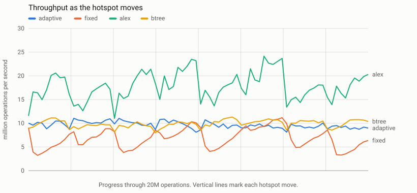
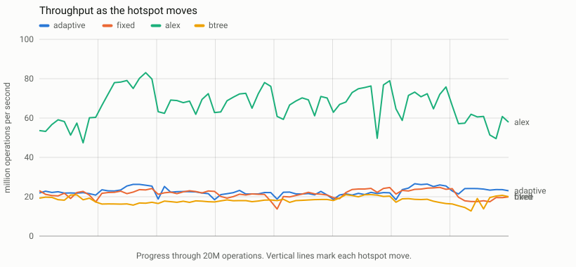
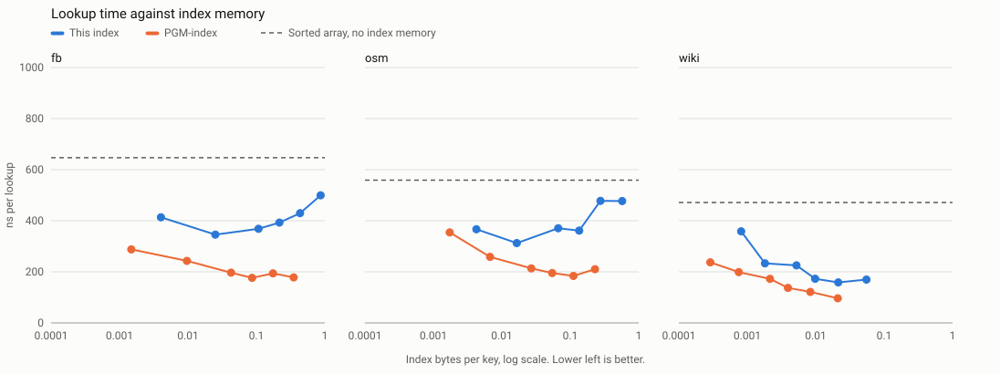

# Benchmark report

Measured on 5 November 2026 on an Apple M5 Pro with 48 GiB of RAM. Every number here comes from a run listed in [results/ARTIFACTS.md](../results/ARTIFACTS.md). All tables are in [results/summary.md](../results/summary.md), generated from raw data by `scripts/summarize.py`.

## Result

**The claim I set out to test does not hold.** On the primary data, the adaptive policy did not beat the best fixed rebuild threshold.

| Hypothesis, primary data, 8 seeds | Measured, adaptive over fixed | Result |
|---|---|---|
| H1: higher throughput on `shifting_hotspot` | 1.033 [0.939, 1.152] | Does not hold |
| H2: higher geometric mean, at least 0.95 on every workload | 0.948 [0.907, 0.994] | Does not hold |
| H3: fewer bytes moved in rebuilds on every workload | 0.000 to 1.000 | Holds, with `append_only` tied |
| Memory within 5 percent of fixed | 0.998 to 1.071 | Does not hold |

Brackets are 95 percent paired bootstrap intervals. One replicate is one seed. Rules are in [experiments/PLAN.md](../experiments/PLAN.md), fixed before any test data was read.

Three findings are still useful:

1. **A tuned threshold does not travel.** Fixed was tuned on Wikipedia timestamps. On OpenStreetMap keys, adaptive beat it by 1.535x [1.419, 1.666] on the moving hotspot and 1.495x [1.432, 1.560] on writes, with no retuning. It used 5.8 to 7.0 percent more memory, which is over my limit, so this does not count as a win under the rule.
2. **Most rebuilds were not worth doing.** On `write_heavy`, fixed moved 58 GB in 187,702 rebuilds. Adaptive moved nothing, and its throughput was 1.076x [1.033, 1.142] higher.
3. **ALEX is faster.** It beat this index by 1.2x to 3.4x on the primary data, using 30 to 48 percent more memory. Nothing here beats ALEX on speed.

## What ran

| Item | Value |
|---|---|
| Update configurations | Picked by a tuning sweep of 39 configurations with 468 processes, on separate data seeds |
| Adaptive | Epsilon 8, margin 1, half-life 2^22 |
| Fixed | Epsilon 16, threshold 64 |
| B+ tree | tlx at 64 slots, the best of 16, 64 and 256 |
| ALEX | Default parameters, no tuning |
| Primary data | `wiki_ts`, 42,959,830 bulk keys, far larger than the 16 MiB L2 cache |
| Hostile data | `osm_cellids` at stride 4, 23,750,072 bulk keys, the dataset a line fits worst |
| Warm data | `wiki_ts` at stride 2048, 46,312 bulk keys, fits in cache |
| Workload size | 20,000,000 operations per process, all with misses |
| Update throughput | 384 processes, 8 seeds, one index per process, median load 5 |
| Latency | 144 processes, 3 seeds, median load 4 |
| Memory | 144 processes, 3 seeds, median load 11 |
| Build flags | `-std=c++20 -O3 -DNDEBUG -mcpu=native`, clang 21 |
| Timing | `steady_clock`, 24 MHz, so single-operation values have 41.7 ns resolution |
| Checksums | 0 mismatches. Every index returned the same answers on every trace |

## Update throughput

Million operations per second, median of 8 seeds. Each ratio is adaptive over that index.

**Primary**

| Workload | Adaptive | Fixed | ALEX | B+ tree | vs fixed | vs ALEX | vs B+ tree |
|---|---:|---:|---:|---:|---|---|---|
| `read_heavy` | 4.68 | 5.69 | 16.31 | 3.85 | 0.821 [0.732, 0.894] | 0.295 [0.249, 0.349] | 1.220 [1.082, 1.379] |
| `write_heavy` | 2.17 | 2.06 | 6.64 | 2.27 | 1.076 [1.033, 1.142] | 0.331 [0.323, 0.339] | 0.972 [0.946, 1.002] |
| `append_only` | 10.11 | 11.31 | 11.92 | 9.95 | 0.884 [0.824, 0.936] | 0.816 [0.752, 0.885] | 1.051 [0.949, 1.194] |
| `shifting_hotspot` | 7.98 | 8.38 | 23.24 | 8.18 | 1.033 [0.939, 1.152] | 0.361 [0.347, 0.374] | 1.040 [0.927, 1.193] |

**Hostile**

| Workload | Adaptive | Fixed | ALEX | B+ tree | vs fixed | vs ALEX |
|---|---:|---:|---:|---:|---|---|
| `read_heavy` | 4.17 | 4.62 | 6.72 | 4.44 | 0.900 [0.830, 0.960] | 0.620 [0.570, 0.667] |
| `write_heavy` | 2.49 | 1.63 | 2.94 | 2.66 | 1.495 [1.432, 1.560] | 0.834 [0.793, 0.882] |
| `append_only` | 7.88 | 8.49 | 9.87 | 10.71 | 0.952 [0.843, 1.056] | 0.867 [0.785, 0.953] |
| `shifting_hotspot` | 9.26 | 5.96 | 17.17 | 9.97 | 1.535 [1.419, 1.666] | 0.557 [0.490, 0.638] |

On warm data, adaptive reached 31 to 48 Mops/s against 30 to 40 for fixed and 61 to 114 for ALEX. H1 and H2 both hold there, at 1.144 [1.025, 1.257] and 1.087 [1.030, 1.138], with memory in limit. That split is secondary, so it does not rescue the claim.

### Through a distribution shift

Each vertical line is a hotspot move. On hostile data, the fixed threshold drops by half at each move and recovers slowly, while adaptive stays flat.





## Why the primary result is negative

The tuning rule picked a different epsilon for each policy, so the headline compares two things at once. I ran an extra comparison at epsilon 16 for both. It is exploratory, was designed after I saw the result, and decides nothing. See `results/update_same_epsilon`.

| Data | Workload | Adaptive over fixed, both at epsilon 16 |
|---|---|---|
| Primary | `read_heavy` | 0.970 [0.940, 1.001] |
| Primary | `write_heavy` | 0.879 [0.832, 0.912] |
| Primary | `append_only` | 1.074 [0.938, 1.201] |
| Primary | `shifting_hotspot` | 0.967 [0.792, 1.139] |
| Primary | Geometric mean | 0.970 [0.913, 1.020] |
| Hostile | Geometric mean | 1.259 [1.202, 1.308] |

So most of the `read_heavy` loss came from epsilon, not from the policy. At equal epsilon, the primary comparison is too close to separate, and the hostile win remains. A second pass would tune adaptive and fixed at one shared epsilon.

Epsilon 8 also explains most of the memory gap: 160,858 leaves against 69,305 on `shifting_hotspot`, which costs 0.44 bytes per key in directory and models against 0.18.

## Rebuild work

Medians of 8 seeds on the quiet run. Counts for a fixed policy do not depend on timing.

| Data | Workload | Policy | Rebuilds | Keys merged | GB moved | Worst rebuild |
|---|---|---|---:|---:|---:|---:|
| Primary | `write_heavy` | Adaptive | 0 | 0 | 0 | 0 |
| Primary | `write_heavy` | Fixed | 187,702 | 214,156,756 | 58.46 | 4,244 us |
| Primary | `shifting_hotspot` | Adaptive | 1 | 314 | 0.00 | 251 us |
| Primary | `shifting_hotspot` | Fixed | 47,612 | 47,366,762 | 10.95 | 213 us |
| Primary | `append_only` | Adaptive | 26,720 | 10,005,089 | 0.16 | 233 us |
| Primary | `append_only` | Fixed | 156,332 | 10,005,248 | 0.16 | 160 us |
| Hostile | `write_heavy` | Adaptive | 0 | 0 | 0 | 0 |
| Hostile | `write_heavy` | Fixed | 87,456 | 24,923,810 | 152.65 | 5,048 us |

H3 fails as written on hostile data, because fixed moved nothing on `read_heavy` and adaptive made one small rebuild, and on warm data, where `append_only` is 1.001. On `append_only`, tail sealing does the same work for both policies.

Adaptive pays for skipping rebuilds. On primary `write_heavy` it shifted 444,743,743 buffered entries against 214,363,912, and made 110,455,603 buffer search steps against 78,475,512. Those figures come from the instrumented binary, which is never timed.

## Latency

Nanoseconds, median of 3 seeds, with each value including one clock read. Warm values sit at the clock's resolution, so only cold data is shown.

| Data | Workload | Index | Read p50 | Read p99 | Write p50 | Write p99 | Worst op |
|---|---|---|---:|---:|---:|---:|---:|
| Primary | `read_heavy` | Adaptive | 209 | 625 | 292 | 625 | 2.8 ms |
| Primary | `read_heavy` | Fixed | 208 | 583 | 250 | 583 | 1.5 ms |
| Primary | `read_heavy` | ALEX | 83 | 334 | 250 | 958 | 1.1 ms |
| Primary | `read_heavy` | B+ tree | 250 | 834 | 500 | 1,792 | 6.9 ms |
| Primary | `write_heavy` | Adaptive | 250 | 917 | 417 | 1,250 | 2.1 ms |
| Primary | `write_heavy` | Fixed | 250 | 917 | 333 | 4,542 | 14.4 ms |
| Primary | `write_heavy` | ALEX | 83 | 375 | 167 | 541 | 2.2 ms |
| Primary | `write_heavy` | B+ tree | 291 | 833 | 500 | 1,083 | 8.9 ms |

Adaptive cut write p99 by 3.6x and the worst pause by 6.7x on `write_heavy`, because it stopped merging. Its write p50 is higher, because the buffers are larger.

## Memory

Bytes per key at allocator capacity, after replay, including keys and payloads. Allocator capacity is what the process really holds, and it caught a bug that the indexes' own size reports could not show.

| Data | Adaptive | Fixed | ALEX | B+ tree |
|---|---:|---:|---:|---:|
| Primary | 17.88 to 19.27 | 17.78 to 18.00 | 25.00 to 26.40 | 21.34 to 35.12 |
| Hostile | 19.76 to 20.71 | 18.62 to 19.39 | 26.12 to 27.55 | 21.78 to 37.61 |
| Warm | 18.15 to 18.61 | 17.90 to 18.32 | 30.94 to 74.78 | 22.54 to 30.80 |

Ranges span the four workloads. [results/update_memory/raw.jsonl](../results/update_memory/raw.jsonl) holds the split between directory, models, buffers and payloads. Peak values in [results/summary.md](../results/summary.md) include the input copies held during bulk load.

Build time on primary data was 0.32 s for this index, 0.41 s for the B+ tree and 6.17 s for ALEX.

## Static lookups

Five seeds, 10,000,000 lookups per process, median load 9 for full data and 6 for warm data. Ratios compare lookup time, so below 1 is faster. Index bytes exclude keys and payloads.



| Dataset, larger than cache | Sorted array | This index, best | PGM, same epsilon | vs sorted array | vs PGM |
|---|---:|---:|---:|---|---|
| `wiki_ts`, epsilon 16, 0.021 bytes per key | 471 ns | 159 ns | 121 ns | 0.326 [0.305, 0.350] | 1.374 [1.303, 1.454] |
| `osm`, epsilon 256, 0.017 bytes per key | 559 ns | 312 ns | 259 ns | 0.564 [0.479, 0.646] | 1.179 [1.026, 1.328] |
| `fb`, epsilon 256, 0.025 bytes per key | 647 ns | 346 ns | 243 ns | 0.588 [0.534, 0.642] | 1.450 [1.249, 1.685] |

- **Against a sorted array:** 1.7x to 3.1x faster when the data is larger than cache.
- **Against PGM:** slower at every epsilon on full data, by 1.1x to 2.8x, and larger by about 2.5x. PGM's optimal segmentation and recursive routing are better, and this comparison does not close that gap.
- **On warm data:** the sorted array is as fast, at 19 to 20 ns. This index ranged from 1.08x slower to 0.72x of its time on `fb` and `wiki_ts`. On `osm`, where a line fits worst, it was 1.2x to 1.4x slower, which is the case where a learned model does not pay. It beat PGM there, 0.65x of its time at epsilon 16.

**Routing correction.** I earlier dropped routing work because a profile put routing at 6 to 20 percent of lookup time. A later diagnostic on `fb` shows 29 percent at epsilon 8 and 11 percent at epsilon 64. So routing matters more at small epsilon, and it accounts for only part of the gap to PGM. I did not measure the rest. One extra cache miss on a model stored apart from its routing key is my leading guess.

## Correctness

| Check | Result | Source |
|---|---|---|
| Differential fuzzing | 2,032,984,796 operations over 500,000 random index shapes, 75.5M rebuilds, 0 mismatches | [fuzz.json](../results/quality/fuzz.json) |
| Correctness suite | 9,874,517 operations checked against an ordered-map oracle | `make test` |
| ASan and UBSan | Full suite clean | `make sanitize` |
| Coverage | 98.26 percent of lines, 93.07 percent of branches | [coverage.json](../results/quality/coverage.json) |
| Mutation testing | 44 of 44 scored mutants caught, 1 equivalent, from a hand-written list of 45. The first honest score was 40 of 44, and I added tests for the four survivors | [mutation.json](../results/quality/mutation.json) |

## Limits of this evidence

- **The rerun came after I saw results.** The first run used a load gate I had relaxed, at median load 149, and I read it before rerunning on a quiet machine. Binary, seeds and rules did not change. The primary verdict was negative both times: H1 0.881 [0.772, 1.037] and H2 0.919 [0.877, 0.960] under load. On hostile data, the shape held at 1.481 and 1.086. Both runs are kept.
- **Tuning was noisy.** The validation sweep ran at median load 153, so nearby configurations differ by less than the noise. The chosen settings may not be the best ones.
- **Some runs passed the original gate.** `static_final`, `update_memory` and `update_work` ran with a relaxed gate, at median loads of 9 to 12 and peaks up to 21. Memory and work counts do not depend on timing for a fixed policy. Adaptive decisions use measured costs, so its counts can shift a little.
- **Latency and memory use 3 seeds, not 8.** I reduced them before the runs, to save time.
- **Shifting hotspots here are synthetic.** The keys are real, but the workload timing is generated.
- **One machine, one thread.** macOS has no public thread pinning, so runs request the highest quality-of-service class instead.

## Reproduce

```bash
scripts/fetch_baselines.sh
```

```bash
scripts/fetch_sosd.sh wiki_ts_200M_uint64
```

```bash
scripts/fetch_sosd.sh osm_cellids_200M_uint64
```

```bash
scripts/fetch_sosd.sh fb_200M_uint64
```

```bash
scripts/run_full_benchmark.sh
```

The last command takes about 2 hours on an idle M5 Pro and writes every table and chart. Delete a folder in `results/` to measure that run again.
